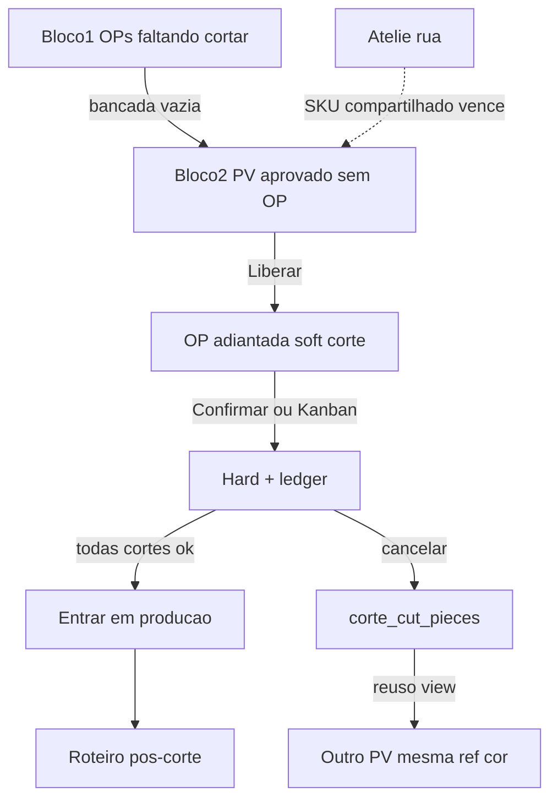

# Fila de Corte unificada — adiantamento com trava pós-corte + reuso

> Spec fechada por grill com o dono em 21/10/2026. **Supersede** em
> [`fila-corte-lookahead.md`](fila-corte-lookahead.md) tudo o que contradisser
> este documento (4 abas, soft integral no promote, ausência de trava pós-corte,
> cancelamento sem peça cortada). Mantém a Sequência oficial
> ([`sequencia-producao.md`](sequencia-producao.md)) e o Ateliê de rua
> ([`atelie-corte-antecipado.md`](atelie-corte-antecipado.md)).

## Goal

Evoluir `/producao/corte-lookahead` num motor único de corte **interno**
(Cabedal · Fibra · Forração) que:

1. mostra o que **já está em produção** e ainda falta cortar na bancada;
2. quando a bancada está ociosa, puxa PV aprovado sem OP para **adiantar**;
3. cria OP adiantada com soft **só dos materiais de corte**;
4. permite confirmar corte (fila ou Kanban) com **hard + ledger anti-2×**;
5. trava o roteiro pós-corte até **Entrar em produção**;
6. no cancelamento após hard, gera **estoque de peça cortada** reutilizável
   noutro pedido (mesma ref×cor×variante, grade livre / adequação na fábrica).

## Decisões fechadas (grill)

| # | Tema | Escolha |
|---|---|---|
| D1 | Onde mora | **Substitui** a Fila de Corte atual (mesmo URL) |
| D2 | Tela | Dois blocos por bancada: (1) em produção faltando cortar; (2) adiantar — só se (1) vazio |
| D3 | Liberar | Cria OP `is_ahead_of_schedule` + soft **só materiais das etapas de corte** |
| D4 | Relatório pré-liberar | PV, cliente, ref, cor, pares/grade, bancada, estoque, **materiais principais** (SKU + nec. + disp.) |
| D5 | Bancadas | **3**: Cabedal · Fibra · Forração (fábrica interna; não rua) |
| D6 | Ciclo OP adiantada | Só etapas de corte até gesto **Entrar em produção** |
| D7 | Sinal de corte feito | Kanban **ou** Confirmar corte → mesmo hard + ledger |
| D8 | Entrar em produção | Exige **todas** as etapas de corte do roteiro `concluido`; multi-select |
| D9 | Ranking bloco 2 | Estoque livre → Sequência oficial. Complexidade = **só Ateliê** |
| D10 | Ateliê | Refs fora até `received_at_factory`. Se mesmo SKU, **Ateliê vence** |
| D11 | 1ª liberação | Cria a OP; outras bancadas veem no bloco 1 |
| D12 | Capacidade | 3 tetos; valor legado “Palmilha” → Fibra |
| D13 | Cancel após hard | Nasce saldo de peça cortada (Cabedal/Fibra/Forração) automático |
| D14 | Reuso | View `?view=reuso` na Fila; mesma ref×cor×variante; por pares; grade informativa; parcial ok |
| D15 | Permissões | Mesmo `can_edit` de Produção / Fila |
| D16 | Escopo v1 | Tudo acima (não fasear reuso) |

## Modelo

```
orders
  is_ahead_of_schedule          (existe)
  corte_ahead_unlocked_at       (NOVA) NULL = pós-corte travado se adiantada

corte_ahead_stock_debits        (NOVA) ledger anti-2× por (order_id, product_id, cut_kind)
  cut_kind ∈ {cabedal, fibra, forracao}
  quantity_debited, pending_qty, movement_id, …

corte_cut_pieces                (NOVA) saldo de peça cortada (cancelamento)
  cut_kind, reference_id, color_norm, material_variant_id
  pairs_available, pairs_original
  source_order_id, source_sale_order_item_id
  original_grade jsonb (informativo)
  status ∈ {available, exhausted, void}

corte_cut_piece_allocations     (NOVA) vínculo reuso → item de PV / OP
  cut_piece_id, sale_order_item_id, order_id, pairs
```

### Pipeline da OP adiantada

```
Liberar (bloco 2)
  → OP is_ahead_of_schedule=true, corte_ahead_unlocked_at=NULL
  → soft só materiais de corte
  → etapas de corte apontáveis; pós-corte BLOQUEADO

Confirmar corte / Kanban fecha etapa de corte
  → hard + ledger corte_ahead_stock_debits
  → etapa concluido

Entrar em produção (todas cortes concluidas)
  → corte_ahead_unlocked_at = now()
  → pós-corte liberado

Cancelar OP com hard já feito
  → corte_cut_pieces (por kind debitado)
  → estorno do raw NÃO devolve napa; vira peça cortada
```

## Requisitos

### R1 — UI / rota
1. `/producao/corte-lookahead` com `?setor=` ∈ {Corte Cabedal, Corte Fibra, Corte Forração} e `?view=` ∈ {fila, reuso}.
2. Por setor: bloco 1 (OPs vivas com etapa da bancada não concluída) + bloco 2 (look-ahead) só se bloco 1 vazio.
3. Relatório do bloco 2 com materiais principais (D4); imprimível/exportável na tela.
4. Capacidade diária editável por bancada (3 tetos).
5. View Reuso: saldos available + vincular a item elegível.

### R2 — Liberação
6. RPC `release_corte_lookahead_items` (evoluída): promote com `p_is_ahead`; soft **apenas** componentes de corte do roteiro do item; cancela/não cria soft de pós-corte.
7. Gate Ateliê + material principal da bancada (como hoje) + bloqueio se SKU com necessidade Ateliê aberta não coberta (`atelier_sku_priority_blocks` ou equivalente).
8. Átomo = item PV → 1 OP; 1ª liberação cria; demais bancadas = bloco 1.

### R3 — Corte hard + anti-2×
9. `confirm_corte_ahead_stage(order_id, cut_kind)` e trigger ao fechar etapa de corte no Kanban (OP adiantada ou qualquer OP? → **toda OP** ao fechar etapa de corte daquele kind, para um sinal só — grill Q18-A; se custo alto, v1 só `is_ahead_of_schedule`).
   - **Decisão de implementação v1:** hard+ledger em **qualquer** fechamento de etapa de corte (Cabedal/Fibra/Forração), não só adiantada — um comportamento de estoque no chão.
10. `hybrid_debit` / settle / restore **pulam** `(order_id, product_id)` já no ledger `corte_ahead_stock_debits` com `quantity_debited > 0` (espelho Ateliê).

### R4 — Trava pós-corte
11. Enquanto `is_ahead_of_schedule AND corte_ahead_unlocked_at IS NULL`, apontamento / finalize de etapa **fora** do conjunto de corte do roteiro → RAISE com mensagem clara.
12. `enter_corte_ahead_production(order_ids uuid[])`: exige todas etapas de corte do roteiro `concluido`; seta `corte_ahead_unlocked_at`.

### R5 — Peça cortada + reuso
13. Ao cancelar OP (ou item) com ledger de corte: INSERT `corte_cut_pieces` por kind com `pairs_available = pairs da OP` (ou qtd proporcional debitada); grade original informativa.
14. `allocate_corte_cut_piece(piece_id, sale_order_item_id, pairs)`: mesma ref×cor×variante; pairs ≤ available; ao promover/existir OP, marca etapas daquele kind `concluido` e registra allocation; não re-debita napa daquele kind (ledger de reuso ou skip).
15. Grade do PV novo manda; não exige compatibilidade de curva.

### R6 — Testes / DoD
16. Contratos de migration + testes puros de ranking/bancadas (3 setores).
17. Typecheck `tsconfig.app.json`; verificação em produção pós-deploy (regra do dono).

## Fora de escopo (explícito)

- Misturar Ateliê/rua nesta fila (corte interno ≠ OS prestador).
- Score de “complexidade interna” além do cadastro Ateliê.
- Agrupamento primário por bobina/cor.
- APS multi-setor.
- Débito hard de materiais que não são do corte da etapa.

## Relação com as-is



## Definition of Done

- [ ] 3 bancadas; Palmilha genérica fora da UI; capacidade migrada.
- [ ] Bloco 2 só com bloco 1 vazio na bancada.
- [ ] Liberar cria OP adiantada; soft só corte; relatório com materiais.
- [ ] Confirmar/Kanban → hard + anti-2×; pós-corte travado até Entrar em produção.
- [ ] Cancel → peça cortada; reuso vincula e pula etapas.
- [ ] Contratos + typecheck verdes.
